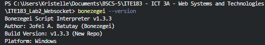
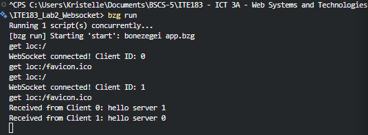
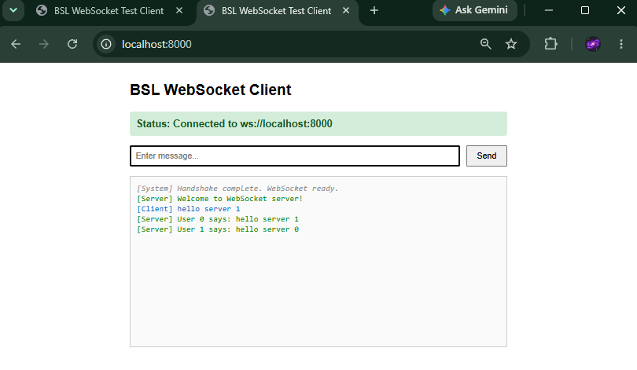
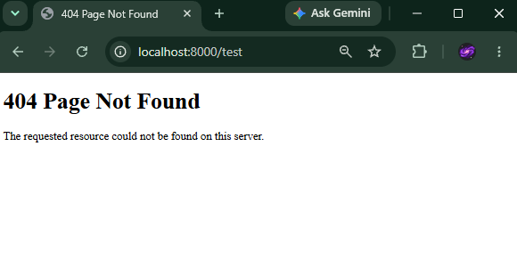

# ITE183_Lab2_Websocket

## Overview

This application serves as a full-duplex communication engine built using the Bonezegei Scripting Language (BSL) version 1.3.3. It handles HTTP requests to deliver static web files, manages connection upgrades for WebSocket sessions, assigns distinct identification tokens to connected sockets, and executes real-time global message multicasting via `server.sendAll()`.

## System Requirements

* Bonezegei Scripting Language interpreter version **1.3.3**
* The built-in package utility (`bzg install`) to fetch the HTTP protocol module
* Any standard web browser supporting modern WebSocket standards

## Installation

1. Install the Bonezegei Scripting Language (BSL) **v1.3.3** interpreter via the Microsoft Store on Windows.
2. Verify the installation by running the following command in your terminal:
```bash
bonezegei --version

```

3. Clone this repository to your local machine:
```bash
git clone https://github.com/Kris2103/ITE183_Lab2_Websocket.git
cd ITE183_Lab2_Websocket

```

4. Install the project dependencies using the package manager (this generates the local `lib/` directory):
```bash
bzg install http

```

## Execution Instructions

Execute the application from the root directory of your workspace:

```bash
bzg run

```

Access `http://localhost:8000/` through multiple browser clients simultaneously. Transmitted text payloads will immediately broadcast across all active interfaces under the identifier structure `User <id> says: <message>`.

## HTTP Routing Table

| Endpoint Pattern | Action / Rendered Output |
| --- | --- |
| `/` | 200 OK - Primary interactive WebSocket client interface |
| Any alternative path (e.g., `/settings`, `/profile`, etc.) | 404 Not Found - Fallback error page |

## Socket Event Handlers

| Event Hook | Functional Behavior |
| --- | --- |
| `server.onConnect` | Captures incoming socket handshakes, registers the client ID, and transmits a greeting |
| `server.onData` | Intercepts inbound user payloads and multicasts data globally using `sendAll()` |
| `server.onDisconnect` | Tracks and logs session terminations alongside corresponding client IDs |

## Project Documentation & Screenshots

### Interpreter Version Verification
  
*Terminal output validating installation of Bonezegei version 1.3.3.*

### Server Startup with bzg run
  
*Terminal output showing package installation from `package.json`, server startup via `bzg run`, and initial client connection events.*

### Concurrent Client Interactivity
  
*Parallel browser sessions connected to http://localhost:8000, illustrating synchronized real-time message broadcasting.*

### Fallback Route Handling
  
*Custom error rendering triggered by undefined endpoint lookups.*

### Terminal Output
  
*Live server terminal logs displaying incoming HTTP requests, WebSocket connection lifecycles, real-time message exchanges between clients, and unmapped route requests (such as `/test`) triggering fallback handling.*

## License Information

This project is distributed under the terms of the [MIT License](https://www.google.com/search?q=LICENSE).
